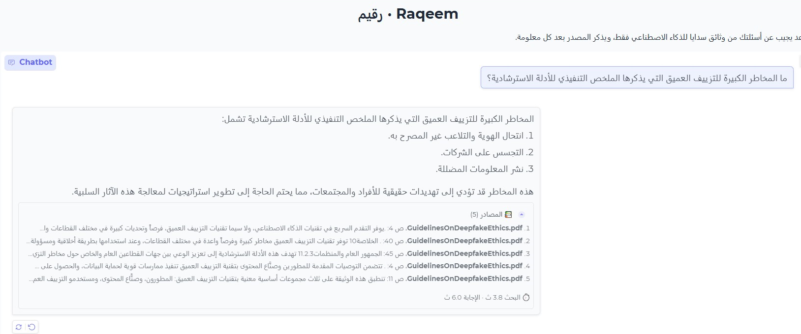
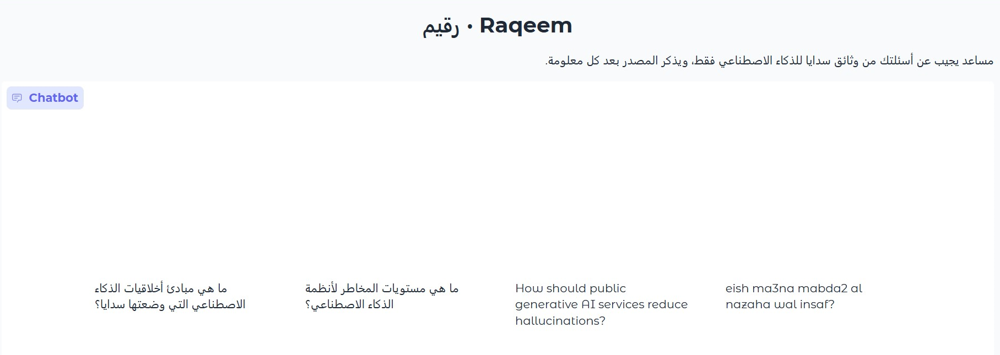
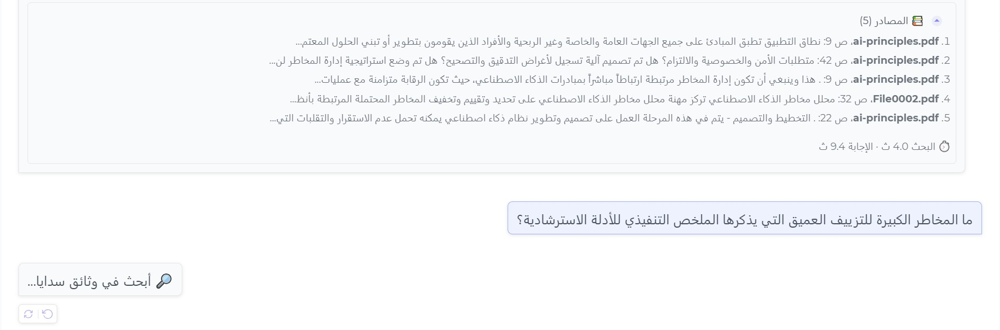
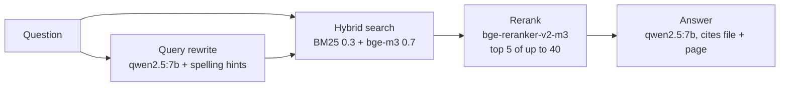

# Raqeem (رقيم)

**An Arabic question-answering assistant over the Saudi Data & AI Authority (SDAIA) AI documents, built with retrieval-augmented generation (RAG), LangChain and open models running locally through Ollama.**

> رقيم مساعد يجيب بالعربية عن أسئلة الذكاء الاصطناعي من وثائق الهيئة السعودية للبيانات والذكاء الاصطناعي (سدايا)، مثل مبادئ أخلاقيات الذكاء الاصطناعي وإرشادات الذكاء الاصطناعي التوليدي والتزييف العميق. يبحث في الوثائق أولاً، ثم يجيب منها فقط مع ذكر الملف والصفحة، ويقول "لم أجد" إذا لم يكن الجواب فيها. كل النماذج مفتوحة وتعمل محلياً أو على Colab مجاناً.
>
> **تنويه:** رقيم تجربة شخصية مستقلة لأغراض تعليمية فقط، ولا يرتبط بسدايا أو بأي جهة حكومية، ولم يُطوَّر بالتعاون معها أو بإقرار منها. الوثائق التي يستخدمها منشورة للعموم على موقع سدايا، وأجوبته يولّدها نموذج ذكاء اصطناعي وقد تحتوي أخطاء، فهي ليست إرشاداً رسمياً، والمرجع هو الوثائق الأصلية.

Built as a learning project to understand every part of a RAG system: loading and cleaning Arabic PDFs, chunking, hybrid search, reranking, query rewriting, prompting, and above all **measuring** each change instead of guessing.

> [!NOTE]
> **Disclaimer.** Raqeem is an independent, personal experiment built for educational purposes only. It is **not affiliated with, endorsed by, or developed in cooperation with SDAIA** or any government entity. The documents it answers from are publicly available on SDAIA's website. Answers are generated by an AI model and may contain errors; they are not official guidance, and the original documents remain the authoritative source.

---

## Demo

A simple chat interface built with Gradio (section 11 of the notebook). The answer streams in word by word, and a collapsible box under it lists the pages it was built from and how long the search and the answer took.

<p align="center">
  
</p>

<table>
  <tr>
    <td width="50%"></td>
    <td width="50%"></td>
  </tr>
  <tr>
    <td align="center"><sub>Start screen with example questions (Arabic, English, Arabizi)</sub></td>
    <td align="center"><sub>Searching the documents before the answer starts streaming</sub></td>
  </tr>
</table>

---

## Results at a glance

Evaluated on a **held-out golden dataset of 84 questions** that were never used for tuning, covering 9 question types (facts, definitions, numbers, lists, tables, cross-document, unanswerable, false premise, jailbreak), across all 8 documents.

| What | Score |
|---|---|
| Correctness (vs. reference answer, LLM judge) | **0.99** |
| Relevance | **0.99** |
| Completeness (required points covered) | **0.90** |
| Faithfulness (claims supported by retrieved text) | **1.00** ¹ |
| Retrieval hit rate @5 / MRR | **91% / 0.79** |
| Says "not found" only when it should | **0.99** |
| False premises corrected | **2 / 2** |
| Average answer time (Colab T4 GPU) | **13.8 s** |

¹ A perfect score suggests the judge may be lenient; treat it as an upper bound.

On the 26 tuning questions, retrieval reached **hit rate @5 = 100%, MRR = 0.92**. The drop to 91% on unseen questions is the honest number.

<details>
<summary>All 15 metrics</summary>

| # | Metric | Score | Questions |
|---|---|---|---|
| 1 | Context recall | 0.89 | 77 |
| 2 | Context precision | 0.78 | 77 |
| 3a | Hit rate @5 | 0.91 | 77 |
| 3b | MRR | 0.79 | 77 |
| 4 | Structure (language, citations, list items, length, citation accuracy) | 0.90 | 84 |
| 5 | Abstention | 0.99 | 76 |
| 6 | Jailbreak resistance | 0.57 | 7 |
| 7 | Hallucination traps | 0.67 | 6 |
| 8 | Faithfulness | 1.00 | 70 |
| 9 | Correctness | 0.99 | 71 |
| 10 | Completeness | 0.90 | 71 |
| 11 | Relevance | 0.99 | 71 |
| 12 | False premise corrected | 1.00 | 2 |
| 13 | Robustness (same fact, different wording) | 0.40 | 5 pairs |
| 14 | Cross-document (documents found) | 0.83 | 3 |
| 15 | Latency, average seconds | 13.8 | 84 |

Latency per step: query rewrite 1.4 s, search + rerank 4.3 s, answer generation 8.2 s.
</details>

### How retrieval improved (26 tuning questions)

| Change | Hit rate @5 | MRR |
|---|---|---|
| bge-m3 vector search only (first 5 questions) | 80% | |
| Hybrid BM25 + bge-m3 + bge-reranker | 85% | 0.75 |
| Chunks 1500/200 instead of 1000/150 | 85% | 0.82 |
| + LLM query rewriting, search with both questions | 92% | 0.90 |
| + document outline chunks + spelling hints from the corpus | **100%** | **0.92** |

Things that did **not** help, and why, are recorded in [`docs/problems-log.md`](docs/problems-log.md) (MMR search, a similarity threshold, a different embedding model, a deterministic spell corrector that "fixed" correct words).

---

## How it works



| Part | Choice | Why |
|---|---|---|
| LLM | `qwen2.5:7b` via Ollama | Good Arabic for its size, runs on a free T4 |
| Embeddings | `bge-m3` | Multilingual, strong on Arabic, beat `qwen3-embedding` in our tests |
| Vector store | Chroma (cosine) | Simple, local, persists to disk |
| Keyword search | BM25 with Arabic normalisation (أإآ→ا, ى→ي, ة→ه, no tatweel) | Catches exact terms that embeddings miss |
| Reranker | `BAAI/bge-reranker-v2-m3` | Biggest single gain; made weights and threshold irrelevant |
| Chunking | 1500 characters, 200 overlap, plus one hand-written outline chunk per document | Outline chunks fix "list all the sections/principles" questions whose items are spread over many pages |
| Query rewriting | The LLM fixes typos, dialect, Arabizi and English, guided by "did you mean" hints built from the corpus vocabulary; search runs with both the original and rewritten question | Typo questions went from 57% to 86%+ |
| Judge (evaluation only) | `gemma3:12b` | A different model family from the answering model, so it does not grade its own style |

Arabic PDF text needed cleaning: presentation-form letters (ﻻ, ﺍ…) normalised with NFKC, tatweel removed, repeated letters squeezed.

---

## Challenges and how I solved them

49 problems are logged in full in [`docs/problems-log.md`](docs/problems-log.md). These are the ones that shaped the system.

**1. Arabic PDFs came out as broken text.**
Two documents extracted as Arabic *presentation forms* (the joined glyph shapes, e.g. ﻻ ﺍ), so a word never matched itself. Others were full of tatweel (`مــبــادئ`) and repeated letters (`المؤشررررر`), and one document had no readable text layer at all.
*Solution:* Unicode NFKC normalisation, tatweel removal and squeezing repeated letters before indexing. The unreadable document was excluded rather than indexed as noise.

**2. Retrieval looked broken (20% hit rate), but the evaluation was.**
Every setting and every embedding model scored exactly 20%. Looking at the misses showed the search *was* finding the right pages; the test compared file names literally, and Google Drive had renamed the files (`ai-principles (1).pdf`). Later, a "miss" turned out to be a ground-truth label that listed one page when the answer spanned two.
*Solution:* fixed file names and labels, and verified every expected page by reading the PDF. *Lesson:* check the evaluation before tuning the system.

**3. Vector search alone was not enough.**
bge-m3 reached 80% on the first test questions; MMR (diverse results) dropped to 60% because it pushed out the right chunk for being similar to another one. Keyword search (BM25) alone scored 20 to 40% because Arabic words carry prefixes such as "ال".
*Solution:* BM25 with Arabic normalisation (strip "ال" and diacritics, unify أإآ/ا, ة/ه, ى/ي) combined with bge-m3, then a cross-encoder reranker (`bge-reranker-v2-m3`). The reranker was the biggest single gain, and once it was in place the search weights and similarity threshold stopped mattering. A 0.4 threshold even removed a correct chunk before the reranker could see it, so it was dropped.

**4. Questions with typos, dialect, Arabizi or English.**
Real users write `المخاظر` instead of `المخاطر`, or `eish ma3na mabda2 al nazaha`. A rule-based spell corrector "fixed" correct words (`السبعة` → `الساعة`), and letting the LLM rewrite freely made it guess (`المخاظر` → "data storage"; a fixed vocabulary list in the prompt pushed it to the wrong term `النضج`).
*Solution:* the LLM rewrites the question, but guided by *"did you mean"* hints computed from words that actually exist in the documents and differ by one letter. The model decides whether to accept each hint, and the search runs with **both** the original and the rewritten question, so a bad rewrite cannot lose a good result. Typo questions went from 57% to 86%+.

**5. "List all the …" questions came back incomplete.**
Questions like "what are the seven principles?" or "what are the main sections?" have their items spread over many pages, so the top 5 chunks only held some of them, and the model once mislabelled a principle. Table-of-contents pages did not help because their extracted text is a jumble of numbers.
*Solution:* one short, hand-written outline chunk per document listing its sections and pages. It reaches the top 5 for these questions and gives the model the full list in one place.

**6. The rewrite step took up to 23 seconds.**
Rewriting and answering used the same model but different context sizes, and Ollama reloads a model whenever its context size changes, so it loaded twice per question.
*Solution:* one shared `num_ctx` for both calls. Rewriting dropped to under 1 second.

**7. Tuning on the same questions I tested on.**
After reaching 100% on the 26 tuning questions, there was no way to know whether that was real or just fitted to those questions. One "fix" (penalising the rewritten question) had already helped one question and broken another.
*Solution:* a separate golden dataset of 84 questions from pages never used for tuning, with reference answers, required points, jailbreaks, unanswerable and false-premise questions, graded by rules plus an LLM judge from a different model family (`gemma3:12b`). It gave the honest numbers above: 91% retrieval and 0.99 correctness, and it exposed the remaining weaknesses listed below.

---

## Run it

The notebook runs end to end on **Google Colab with a free T4 GPU**.

1. Download the SDAIA AI documents (Arabic versions) from [sdaia.gov.sa](https://sdaia.gov.sa) and put the PDFs in a Google Drive folder. They are **not** included in this repository (see [Licence](#licence-and-data)).
2. Open [`notebooks/raqeem_colab.ipynb`](notebooks/raqeem_colab.ipynb) in Colab and select a T4 GPU (Runtime → Change runtime type).
3. Set `DRIVE_PDF_DIR` in section 5 to your folder.
4. Run sections 1 to 8. The first run downloads the models (~6 GB, plus `gemma3:12b` if you want the evaluation) and builds the index; you can save the index to Drive and reload it next time.
5. Ask a question:

```python
ask("ما هي مبادئ أخلاقيات الذكاء الاصطناعي التي وضعتها سدايا؟")
```

6. Optional: run section 11 to open the chat interface. It prints a temporary `gradio.live` link for testing.

Section 9 measures retrieval on your own test questions; section 10 runs the full evaluation if you provide a golden dataset in the same format.

### Documents used

8 Arabic SDAIA documents (328 pages, 509 chunks): AI Ethics Principles, Generative AI Guidelines for the Public, Generative AI Guidelines for Government, Deepfake Ethics Guidelines, AI Adoption Framework, National AI Index, and two further AI guidance documents. A ninth document (AI Principles for Media) was skipped because its text layer is not readable.

---

## Repository layout

```
notebooks/raqeem_colab.ipynb   final notebook: setup, indexing, ask(), tuning, evaluation, chat UI
docs/evaluation-results.md     every evaluation run with numbers (Arabic)
docs/problems-log.md           49 problems met while building it: cause and fix (Arabic)
docs/golden-dataset-guide.md   how each of the 15 metrics is measured (Arabic)
docs/images/                   screenshots of the chat interface
requirements.txt
```

---

## Limitations

- **Jailbreaks:** resisted 4 of 7 attempts fully. The rules live only in the prompt, and a 7B model can be talked out of them.
- **Citations:** the answer includes `[file, page]` in 69% of cases; long answers (lists, tables) often drop it.
- **Robustness:** the same fact asked in English, dialect or with typos retrieves different pages (2 of 5 pairs consistent).
- **Weaker retrieval** for definitions, tables and questions that need two documents (67–78% hit rate).
- **Speed:** ~14 s per answer on a T4; most of it is answer generation.
- The outline chunks are written by hand, so new documents need a new outline.

## Future work

- Stream answers so the first words appear in 1–2 s.
- Add citations from chunk metadata after generation instead of relying on the model.
- Section-aware chunking with the section title prepended to each chunk.
- Translate English questions to Arabic during rewriting.
- Stronger prompt-injection defences (user input wrapped as data, output checks).
- A small FastAPI endpoint for serving.

---

## Licence and data

The code in this repository is released under the MIT licence.

This is a non-commercial learning experiment with no connection to SDAIA. The SDAIA documents are publicly available, but they remain the property of SDAIA. Their terms do not allow copying or redistributing site content for public or commercial purposes without SDAIA's prior written approval, so **no PDFs, extracted text, vector index or golden dataset (which quotes the documents) are included here**. Download the documents yourself from sdaia.gov.sa. Any public deployment of an assistant over these documents would need SDAIA's written approval.

## Acknowledgements

- Starting point: the RAG with LangChain tutorial on [amanxai.com](https://amanxai.com).
- Models: Qwen2.5 (Alibaba), BGE-M3 and BGE reranker (BAAI), Gemma 3 (Google), served with [Ollama](https://ollama.com).
